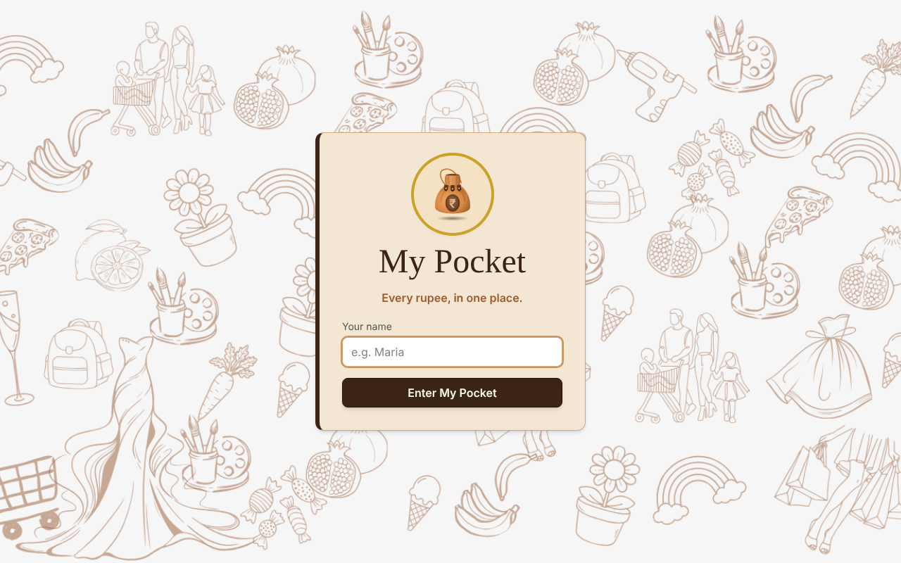
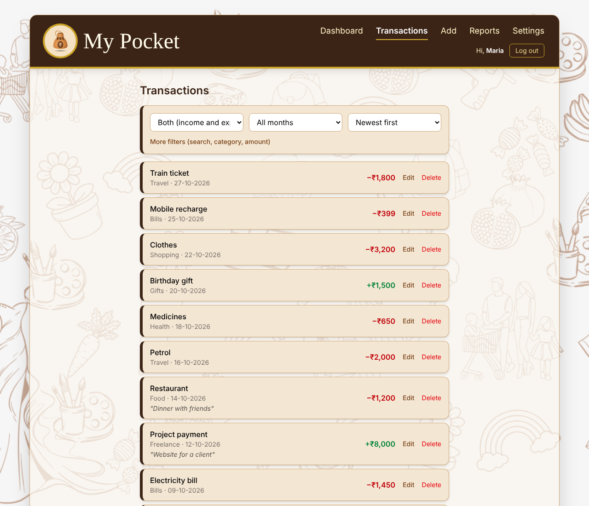
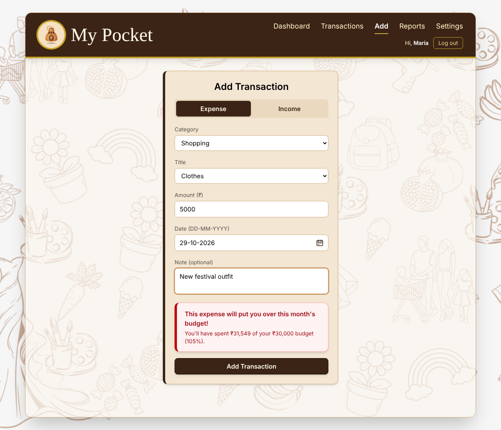
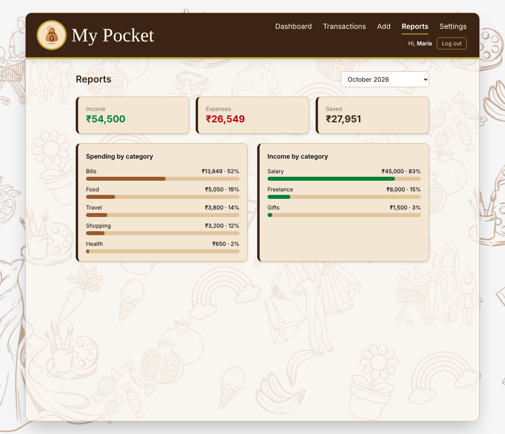

# My Pocket

**Every rupee, in one place.**

My Pocket is a personal finance app built with React. Record your income and expenses, sort them into categories, search and filter them, see reports by category, set a monthly budget with a warning when you get close, and check your balance in US dollars and euros at today's rates. Everything is saved in your browser, so your data is still there when you come back. Each person who logs in sees only their own records.

Built for **Milestone 3: React – Modern UI Development - Expense Manager**.

🔗 **Live site:** https://my-pocket-gilt.vercel.app

---

## Features

- **Login:** a simple name-only login. Every page is protected, and you're sent to the login page if you're not signed in. You start logged out every time you open the app (a refresh keeps you in; closing the tab logs you out)
- **Separate data for each person:** transactions and budget are saved under the logged-in name, so another name sees an empty account
- **Dashboard:** balance, this month's income and expenses, a monthly budget bar, the latest transactions, and a budget warning at 80%
- **Live currency conversion:** see your balance in USD and EUR using the free [Frankfurter API](https://frankfurter.dev), with a loading skeleton and an error message with "Try again"
- **Transactions:** add, edit and delete income or expenses with amount, category, title, date and an optional note
- **Filters:** show expenses, income or both, pick a month, and order by newest or oldest. "More filters" adds search by title or note, a category filter and sort by amount
- **Confirm before delete:** a pop-up asks "Delete this transaction?" before anything is removed
- **Balance check:** an expense bigger than your available balance is refused with a pop-up
- **Zero Balance message** on the Dashboard when income and expenses are equal
- **Budget warning on the forms:** the Add and Edit forms warn you at 80% of the monthly budget before you save
- **Reports:** income, expenses and savings for any month, plus category breakdowns with bars and percentages
- **Settings:** set or remove a monthly budget
- **Calendar picker** for dates, shown as DD-MM-YYYY, and amounts in rupees with Indian formatting (₹1,50,000)
- **Form validation** with clear messages
- **Empty states** instead of blank screens, and an **animated 404 page**
- **Responsive design** for phones, tablets and laptops
- **Saved in localStorage**, so data survives a refresh

---

## Pages

| Page | Address | Protected? |
|---|---|---|
| Login | `/login` | No |
| Dashboard | `/` | Yes |
| Transactions | `/transactions` | Yes |
| Add Transaction | `/add` | Yes |
| Edit Transaction | `/edit/:id` (dynamic route) | Yes |
| Reports | `/reports` | Yes |
| Settings | `/settings` | Yes |
| Not Found | any other address | Yes |

---

## Component tree

```
main.jsx
└── BrowserRouter
    └── AuthProvider                 (Context: who is logged in)
        └── TransactionsProvider     (Context: transactions + budget)
            └── App                  (routes + page background)
                ├── Login
                │   ├── Card
                │   └── LogoBadge ── Logo
                └── ProtectedRoute   (redirects to /login if no user)
                    └── Layout       (centred panel, drawn once)
                        ├── Navbar ── LogoBadge ── Logo
                        └── <Outlet>  one of these pages:
                            ├── Dashboard
                            │   ├── Card, LogoBadge, StatBox ×3
                            │   ├── BudgetAlert
                            │   ├── CurrencyCard ── Skeleton   (useExchangeRates)
                            │   ├── ProgressBar
                            │   └── TransactionRow ×5
                            ├── Transactions
                            │   ├── FilterBar     (filters lifted up into Transactions)
                            │   ├── TransactionRow
                            │   ├── Modal         (confirm before delete)
                            │   └── EmptyState
                            ├── AddTransaction ── TransactionForm ── Card, BudgetAlert, Modal
                            ├── EditTransaction ── TransactionForm / EmptyState
                            ├── Reports ── StatBox ×3, Breakdown ×2 ── ProgressBar
                            ├── Settings ── Card, ProgressBar, BudgetAlert
                            └── NotFound ── CoinsAnimation ── Logo
```

### What lives where, and why

| State | Where | Why |
|---|---|---|
| Logged-in user | `AuthContext` | The Navbar, Login page and ProtectedRoute all need it |
| Transactions and budget | `TransactionsContext` | Almost every page reads or changes them. They are saved per person (`transactions:<name>`, `budget:<name>`) |
| Filters (search, type, category, month, sort) | `Transactions` page, passed to `FilterBar` | Only this page uses them. This is **lifting state up**: the child shows the filters, the parent owns them |
| Form fields | `TransactionForm` | Only the form needs them until you press Save |
| Delete confirmation | `Transactions` page | Only this page knows which transaction is waiting to be deleted |
| Exchange rates | `useExchangeRates` hook inside `CurrencyCard` | Only fetched when asked for, and only used there |

### Custom hooks

- **`useLocalStorage(key, startValue)`:** like `useState`, but also saves to localStorage (the key includes the person's name)
- **`useTransactions()`:** reads the transactions Context
- **`useAuth()`:** reads the login Context
- **`useExchangeRates(enabled)`:** fetches live rates with `useEffect`, returning `{ rates, loading, error, retry }`. It cancels the request with an `AbortController` if the component goes away

---

## Tech stack

| Tool | Used for |
|---|---|
| [React 19](https://react.dev) | Components, hooks and Context |
| [Vite](https://vite.dev) | Development server and production build |
| [React Router 7](https://reactrouter.com) | Pages, protected route and dynamic route |
| [Tailwind CSS 4](https://tailwindcss.com) | Styling and responsive layout |
| [Frankfurter API](https://frankfurter.dev) | Live exchange rates (free, no key) |
| localStorage | Saving data in the browser |
| Vercel | Hosting the live site |

No state libraries (Redux, Zustand) and no component libraries are used: every component is hand-built.

---

## Project structure

```
src/
├── components/   Card, StatBox, ProgressBar, EmptyState, BudgetAlert, Skeleton,
│                 TransactionRow, TransactionForm, FilterBar, CurrencyCard, Modal,
│                 Navbar, Layout, ProtectedRoute, Logo, LogoBadge, CoinsAnimation
├── context/      AuthContext, AuthProvider, TransactionsContext, TransactionsProvider
├── hooks/        useLocalStorage, useTransactions, useAuth, useExchangeRates
├── pages/        Login, Dashboard, Transactions, AddTransaction, EditTransaction,
│                 Reports, Settings, NotFound
├── utils/        budget, categories, formatDate, formatMoney, styles
├── App.jsx       routes
├── main.jsx      starts the app inside the router and both Context providers
└── index.css     Tailwind, brand font and the 404 animation
```

---

## Run it on your computer

You need [Node.js](https://nodejs.org) installed.

```bash
git clone https://github.com/mariadesousasfx71-source/my-pocket.git
cd my-pocket
npm install
npm run dev
```

Then open the address shown in the terminal (usually `http://localhost:5173`) and log in with any name.

---

## Screenshots

| Login | Dashboard |
|---|---|
|  |  |

| Transactions | Add Transaction |
|---|---|
|  |  |

| Reports | 404 page |
|---|---|
|  |  |

---

## Author

**Maria de Sousa**, Full Stack Development student at WsCube Tech.
