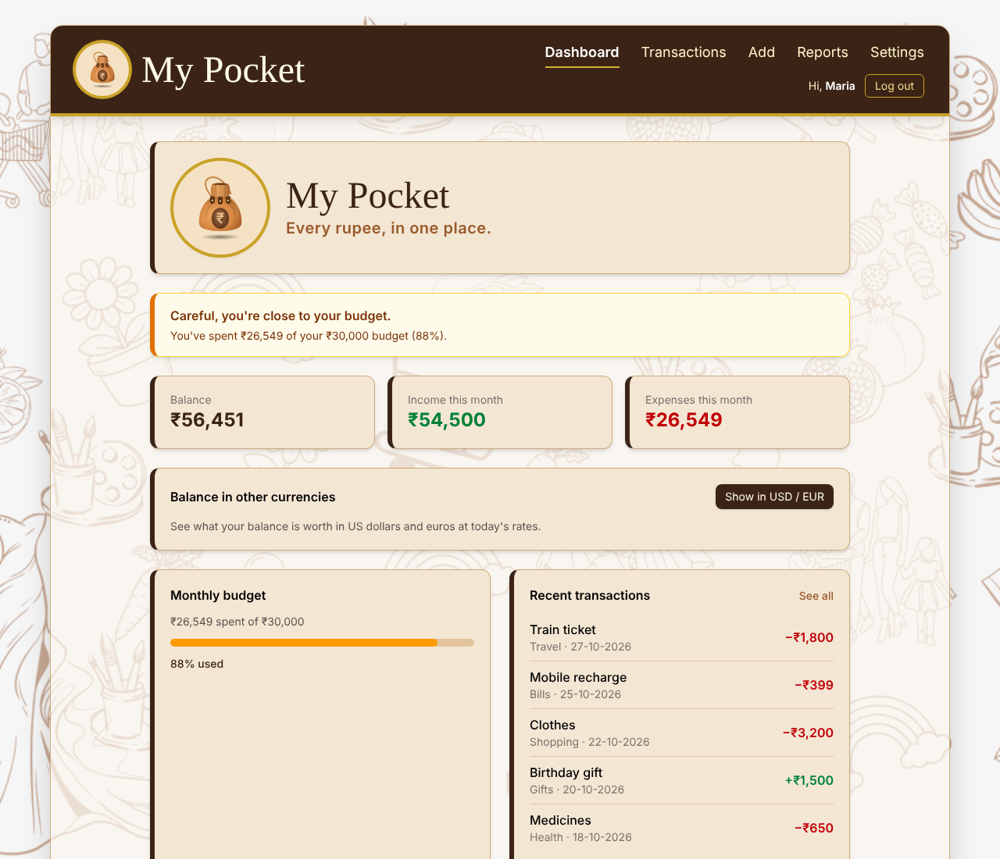
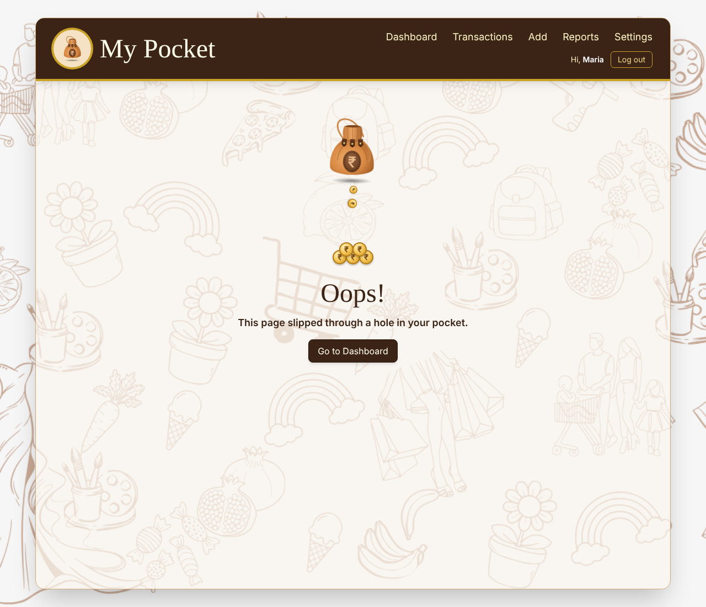

# My Pocket

**Every rupee, in one place.**

My Pocket is a personal expense manager built with React. You can record your daily spending, sort it into categories, search and filter it, and see where your money goes on a simple dashboard. Everything is saved in your browser, so your expenses are still there when you come back.

Built for **Milestone 3: React – Modern UI Development**.

🔗 **Live site:** _add your Vercel link here_

---

## Features

- **Dashboard:** this month's spending, all-time total, number of expenses, spending by category (with bars), and the five most recent expenses
- **Add an expense:** choose a category, pick a title from suggestions or type your own, enter the amount and date
- **Edit and delete** any expense
- **Search** expenses by title
- **Filter** by category and by month, with a running total for what's shown
- **Calendar picker** for dates, shown in Indian format (DD-MM-YYYY)
- **Amounts in rupees** with Indian number formatting (₹1,50,000)
- **Form validation:** empty titles, amounts of ₹0 or less, and impossible dates (like 31-02-2026) are rejected with a clear message
- **Saved automatically** in the browser with localStorage
- **Responsive design** that works on phones, tablets and laptops
- **Animated 404 page:** coins fall out of the pouch when you visit a page that doesn't exist

---

## Pages

| Page | Address | What it does |
|---|---|---|
| Dashboard | `/` | Summary cards, spending by category, recent expenses |
| Expenses | `/expenses` | Full list with search, filters, edit and delete |
| Add Expense | `/add` | Form to add a new expense |
| Edit Expense | `/edit/:id` | The same form, filled in with an existing expense |
| Not Found | any other address | Friendly 404 page with an animation |

---

## Project structure

```
my-pocket/
├── public/
│   ├── doodle.svg            # doodle-art background pattern
│   └── favicon.svg           # pouch logo for the browser tab
├── src/
│   ├── components/
│   │   ├── Navbar.jsx        # top bar with logo and links
│   │   ├── Logo.jsx          # the pouch logo (SVG)
│   │   ├── LogoBadge.jsx     # logo inside a round badge
│   │   ├── ExpenseForm.jsx   # shared form for Add and Edit
│   │   └── CoinsAnimation.jsx# falling-coins animation for the 404 page
│   ├── pages/
│   │   ├── Dashboard.jsx
│   │   ├── Expenses.jsx
│   │   ├── AddExpense.jsx
│   │   ├── EditExpense.jsx
│   │   └── NotFound.jsx
│   ├── utils/
│   │   ├── formatMoney.js    # 1500 → "₹1,500"
│   │   └── formatDate.js     # converts between YYYY-MM-DD and DD-MM-YYYY
│   ├── App.jsx               # expense data, localStorage and routes
│   ├── main.jsx              # starts the app inside BrowserRouter
│   └── index.css             # Tailwind, brand font and animations
└── index.html
```

---

## How it works

- **State lives in `App.jsx`.** The list of expenses is kept with `useState`, and the add, update and delete functions are passed down to the pages as props.
- **Saving.** A `useEffect` saves the list to localStorage with `JSON.stringify` whenever it changes. When the app starts, it loads the list back with `JSON.parse`.
- **Never changing state directly.** New lists are always created: `[...expenses, newItem]` to add, `map` to update one item, and `filter` to delete.
- **Calculations.** `reduce` adds up totals and groups spending by category. `filter` handles search, category and month filters. `toSorted` shows the newest expenses first without changing the original list.
- **Routing.** `BrowserRouter`, `Routes` and `Route` handle the pages. `NavLink` highlights the current page, `useParams` reads the expense id on the Edit page, and `useNavigate` returns to the list after saving.
- **Dates.** Dates are stored as `YYYY-MM-DD` (so they sort correctly) and shown as `DD-MM-YYYY`.

---

## Run it on your computer

You need [Node.js](https://nodejs.org) installed.

```bash
git clone https://github.com/mariadesousasfx71-source/my-pocket.git
cd my-pocket
npm install
npm run dev
```

Then open the address shown in the terminal (usually `http://localhost:5173`).

To make a production build:

```bash
npm run build
```

---

## Screenshots

_Add screenshots here, for example:_

<!--




-->

---

## Author

**Maria de Sousa**, Full Stack Development student at WsCube Tech.
